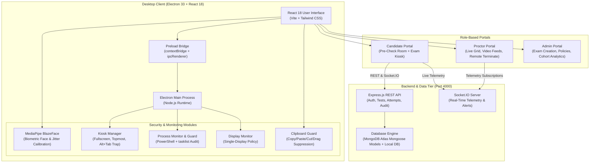

# VigilExam — Secure Online Examination & AI Proctoring System

[](https://www.electronjs.org/)
[](https://react.dev/)
[](https://nodejs.org/)
[](https://expressjs.com/)
[](https://socket.io/)
[](https://www.mongodb.com/)
[](https://mediapipe.dev/)
[](https://tailwindcss.com/)
[](LICENSE)

**VigilExam** is an enterprise-grade desktop examination and real-time proctoring platform developed for **B.Tech Computer Science & Engineering at Walchand College of Engineering, Sangli**.

Unlike conventional web-only testing portals that can easily be compromised via second monitors, virtual machines, or remote-control tools, VigilExam combines a **sandboxed Electron desktop kiosk lockdown**, a **Windows native OS process monitoring engine**, **in-browser AI biometric face calibration**, **real-time Socket.IO telemetry streaming**, and **external assessment platform integrations (HackerRank / HackerEarth)**.

---

## 🏛️ System Architecture



---

## 👥 Project Division & Responsibilities

| Team Member | Project Domain | Core Focus Areas |
| :--- | :--- | :--- |
| **Ritesh Jagtap** | **Frontend & AI Biometrics** | React 18 UI, MediaPipe BlazeFace AI, Portal Workflows, Pre-Check Verification, Process Panel UI |
| **Rugved Ganapule** | **Electron.js Desktop Application** | Electron Architecture, Kiosk Lockdown, Native Windows Process Guard, Multi-Display Audit |
| **Gaurav Patil** | **Backend & Cloud Database** | Express REST API, Socket.IO Telemetry, MongoDB Atlas Mongoose Integration, Security/Auth |
| **Amit Rane** | **Assessment Engine & Integrations** | Test Generation, HackerRank / HackerEarth Integrations, Automated Test Engineering (60 Tests) |

---

## 📌 Detailed Domain Breakdown & Viva Explanations

---

### 1. Ritesh Jagtap — Frontend & Client-Side AI Biometrics

#### 📁 Key Files & Directories
- `src/App.jsx` — Central application state router and candidate flow controller (`dashboard` → `precheck` → `exam` → `result`).
- `src/pages/Login.jsx` — Multi-portal authentication interface with strict visual role indicators and client-side credential validation.
- `src/pages/student/StudentDashboard.jsx` — Student assessment feed, test assignment cards, and pre-exam launcher.
- `src/pages/student/PreCheckRoom.jsx` — Mandatory 5-point hardware and perimeter clearance gatekeeper.
- `src/pages/student/ExamKiosk.jsx` — Active examination kiosk UI, question navigation palette, answer timer, and live warning overlays.
- `src/pages/proctor/ProctorDashboard.jsx` — Proctor control hub with student grid, live video cards, risk scores, and one-click termination.
- `src/pages/admin/AdminDashboard.jsx` — Exam creation forms, policy configurator, student cohort manager, and audit logs.
- `src/components/ProcessManagementPanel.jsx` — Live process table, categorization badges, PID search, and safe close confirmation modals.
- `src/security/faceMonitor.js` — MediaPipe BlazeFace wrapper with wall-clock time calibration and transient jitter tolerance.
- `src/context/AuthContext.jsx` & `src/context/SocketContext.jsx` — React Context providers for authentication and real-time socket connections.

#### 🛠️ Technologies Used
React 18.3, Vite 6, Tailwind CSS 3.4, Lucide React icons, MediaPipe BlazeFace (`@mediapipe/tasks-vision`), HTML5 WebRTC `navigator.mediaDevices`.

#### 💡 Core Technical Concepts Implemented
1. **Wall-Clock Facial Presence Calibration**:
   - Rather than counting arbitrary video frames (which freeze or desynchronize under heavy CPU load), the calibration tracks continuous wall-clock elapsed time:
     $$\Delta t = t_{\text{current}} - t_{\text{calibration\_start}}$$
   - Requires exactly $1$ face present continuously for $\ge 2000\text{ ms}$ (`2/2s`).
   - Implements a **600ms transient jitter tolerance grace period** (`gracePeriodMs = 600`): natural blinks or single dropped frames do not reset the counter back to zero.
   - Detects absence ($0$ faces) or multiple persons ($\ge 2$ faces) and immediately revokes clearance.
2. **Deterministic Pre-Exam Gatekeeper**:
   - The "ENTER SECURE EXAM KIOSK" button is strictly disabled until all 6 criteria evaluate to `passed`:
     $$\text{Clearance} = \text{Camera} \land \text{Mic} \land \text{Face (2/2s)} \land \text{SingleDisplay} \land \text{NetworkLatency} \land (\text{ProhibitedApps} = 0)$$
   - Zero bypass loopholes: If any prohibited app is detected, a warning banner dynamically lists the offending apps and blocks entry.
3. **Role-Isolated UI Workflows**:
   - Complete architectural separation between Student, Proctor, and Admin interfaces.
   - Proctors receive real-time Socket.IO broadcasts and render live camera cards, while students are strictly locked into the exam canvas.

#### 🎙️ How Ritesh Explains This in a Presentation/Viva:
> *"I developed the complete frontend interface and the client-side computer vision pipeline. The core challenge was making sure no student enters the exam without genuine hardware and biometric clearance. I integrated Google MediaPipe's BlazeFace model in WebAssembly to run entirely in the student's browser with zero server lag. I solved the face detection freeze issue by implementing a continuous wall-clock elapsed-time calibration algorithm with a 600ms jitter grace period so natural blinking doesn't break verification. I also built the PreCheckRoom and ProcessManagementPanel components, which give candidates clear feedback on running apps and hardware status before locking down into the examination kiosk."*

---

### 2. Rugved Ganapule — Electron.js Desktop Shell, Kiosk Lockdown & Native OS Process Guard

#### 📁 Key Files & Directories
- `electron/main.js` — Electron application lifecycle, IPC message routing, browser window lifecycle, and clipboard policy dispatch.
- `electron/preload.js` — Secure Preload bridge exposing controlled APIs through Electron's `contextBridge` (`window.vigilNative`).
- `electron/kioskManager.js` — Operating-system level window lockdown manager.
- `electron/processMonitor.js` — Native OS process inspection engine, PowerShell JSON query pipeline, and safe termination engine.
- `electron/processGuard.js` — Secondary guard for background process tracking and baseline delta analysis.
- `electron/securityPolicy.js` — Central security policy database containing protected OS system processes, prohibited apps catalog, and friendly name mappers.
- `electron/displayMonitor.js` — Display adapter audit detecting secondary monitors and multi-head graphics configurations.
- `src/utils/clipboardSecurity.js` — Comprehensive keyboard, context menu, and clipboard event suppression engine.

#### 🛠️ Technologies Used
Electron 33, Node.js `child_process` (`execFile`), Windows PowerShell CLI, Windows `taskkill.exe` & `tasklist.exe`, Electron `screen`, `clipboard`, and `BrowserWindow` APIs.

#### 💡 Core Technical Concepts Implemented
1. **Strict Context Isolation & Secure IPC**:
   - `nodeIntegration: false`, `contextIsolation: true`, and `sandbox: false` with strictly typed IPC handlers.
   - No direct Node.js access is exposed to the renderer; only whitelisted methods (`scanProcesses`, `enableKioskMode`, etc.) are accessible via `window.vigilNative`.
2. **Kiosk Window Lockdown Engine**:
   - Windows desktop enforcement: `kiosk: true`, `fullscreen: true`, `alwaysOnTop: true`, `skipTaskbar: true`.
   - Prevents minimizing, resizing, window closing (`event.preventDefault()` on `'close'`), or switching out of the window.
   - Monitors window blur events: If the candidate attempts to Alt+Tab or activate another task, an instantaneous violation event is fired to the backend.
3. **Native Windows Process Enumeration & Classification**:
   - Directly executes PowerShell:
     ```powershell
     Get-Process | Select-Object Id, ProcessName, Path, StartTime, MainWindowHandle | ConvertTo-Json -Compress
     ```
   - Normalizes process outputs and classifies every active PID into 7 distinct categories:
     - `SYSTEM_PROTECTED`: Windows kernel services (`smss.exe`, `csrss.exe`, `dwm.exe`, `explorer.exe`). Never terminated.
     - `VIGILEXAM_REQUIRED`: App runtimes (`vigilexam.exe`, `electron.exe`, `node.exe`).
     - `DEVELOPMENT_TOOL`: VS Code (`Code.exe`) allowed conditionally via `ALLOW_VSCODE_DURING_DEVELOPMENT = true`.
     - `PROHIBITED_APPLICATION`: Remote access (AnyDesk, TeamViewer, UltraViewer, RustDesk), recording (OBS, Bandicam), AI desktop apps (ChatGPT, Claude), communication (Discord, Telegram).
     - `BACKGROUND_SERVICE`: Pure Session 0 services without windows (`MainWindowHandle === 0`).
     - `NORMAL_USER_APPLICATION`: General browsers, Spotify, media players.
     - `UNKNOWN`: Unrecognized processes (protected by default to preserve system stability).
4. **Safe Process Termination Pipeline**:
   - Targeted, safe PID closure: Re-validates the PID live in the OS before attempting closure.
   - Executes graceful termination first (`taskkill /PID <pid>`), waits 500ms, then force terminates child trees (`taskkill /F /T /PID <pid>`), with a PowerShell fallback (`Stop-Process -Force`).
   - Uses `isPidAlive(pid)` to verify that the application has genuinely terminated before reporting success to the UI.
5. **Operating System Clipboard Lockdown**:
   - Automatically purges clipboard memory on exam entry and exit (`clipboard.clear()`).
   - Suppresses `copy`, `cut`, `paste`, `beforeinput` (paste events), right-click context menus, and text drag-and-drop.

#### 🎙️ How Rugved Explains This in a Presentation/Viva:
> *"I designed the Electron desktop container and the native Windows operating system security engine. Web browsers cannot prevent students from running screen-sharing software or connecting second monitors; Electron gives us access to OS-level system calls while maintaining strict sandbox isolation. I created the process scanner that runs PowerShell commands directly against the Windows kernel to inspect every running process, matching them against our prohibited software matrix including UltraViewer, AnyDesk, and OBS. I built the safe termination handler so students can close unauthorized apps right from the exam interface without needing Task Manager. Additionally, I implemented the kiosk lockdown that captures display metrics and prevents Alt+Tab, multi-monitor cheating, and clipboard leaks."*

---

### 3. Gaurav Patil — Backend Engine, Real-Time WebSockets & Database Architecture

#### 📁 Key Files & Directories
- `server/index.js` — Main Express application, HTTP REST API routing, Socket.IO event multiplexer, and token verification middlewares.
- `server/db.js` — High-performance persistent JSON data store with automatic atomic file syncing and database seeding.
- `server/mongodb.js` — MongoDB Atlas connection manager with Mongoose ODM integration, status diagnostics, and credential protection.
- `server/models/index.js` — Mongoose schema definitions:
  - `User.js` — Student, Proctor, and Admin accounts with password hashing and role validation.
  - `Exam.js` — Examination metadata, time limits, marks, question structures, and policy flags.
  - `ExamAttempt.js` — Live candidate sessions, risk scores, answer tracking, and termination states.
  - `SecurityEvent.js` — Timestamped audit events (tab switch, face lost, multi-face, prohibited process detected).
  - `ProctorWarning.js` — Proctor-to-candidate warning logs.
  - `AuditLog.js` — Administrative operations and system integrity audit trails.
- `src/config/api.js` — Centralized API configuration unifying backend and socket traffic onto port 4000.

#### 🛠️ Technologies Used
Node.js (ES Modules), Express 4.21, Socket.IO 4.8, MongoDB Atlas, Mongoose 8.7, Node.js `crypto` (`scrypt`, `randomBytes`, `timingSafeEqual`, `createHmac`), `bcryptjs`.

#### 💡 Core Technical Concepts Implemented
1. **Unified Backend Architecture (Port 4000)**:
   - Eliminated cross-port connection mismatches by consolidating all REST endpoints and WebSocket handshakes onto a single configured port (`http://localhost:4000`).
   - Embedded backend auto-starter: In packaged production mode (`VigilExam.exe`), Electron automatically bootstraps the internal Express server asynchronously without requiring manual terminal commands.
2. **Cryptographic Authentication & Role-Based Access Control (RBAC)**:
   - Custom salted password hashing using Node.js native `crypto.scrypt`:
     $$\text{DerivedKey} = \text{scrypt}(\text{password}, \text{salt}, 64)$$
   - Tamper-proof session tokens signed with HMAC-SHA256 (`signature = HMAC-SHA256(header.payload, secret)`).
   - Strict server-side role gating: Student tokens cannot query proctor streams, proctors cannot access administrative settings, and administrative accounts require a protected bootstrap token.
3. **Real-Time Bidirectional Proctoring Pipeline (Socket.IO)**:
   - Dedicated socket rooms: Proctors join `proctor:live`, while candidates stream telemetry to `telemetry:push`.
   - Events emitted in real-time:
     - `student_started_exam` — Candidate enters secure kiosk.
     - `telemetry_update` — Live webcam snapshot, biometric status, and current active question index.
     - `violation_alert` — Critical security infractions (multiple faces, prohibited application launched).
     - `proctor_warning` — Live warning banner pushed directly to candidate screen.
     - `force_terminate_session` — Remote instant termination of a compromised exam session.
4. **Cloud Database Architecture with MongoDB Atlas**:
   - Dual-tier data resilience: Connects to MongoDB Atlas using Mongoose with automated retry logic, falling back seamlessly to an atomic local store if offline.
   - Enforces database schemas that strictly forbid storing confidential clipboard text or unhashed passwords.
5. **Server-Side Security Clearance Validation**:
   - The `/api/attempts/start` endpoint strictly verifies candidate clearance telemetry. If `clearance.prohibitedCount > 0` or `clearance.isProcessPassed === false`, the server rejects exam entry with an `HTTP 403 Forbidden` response.

#### 🎙️ How Gaurav Explains This in a Presentation/Viva:
> *"I designed and implemented the backend architecture, real-time communication pipeline, and database systems. The backend runs on Node.js and Express at port 4000, serving both REST APIs and bidirectional Socket.IO streams. I built the role-based authentication using cryptographically salted scrypt password hashing and HMAC-SHA256 signed session tokens. For real-time proctoring, I architected a room-based WebSocket system where student telemetry—including live frame snapshots, face confidence, and violation events—is streamed instantly to the proctor dashboard with sub-100ms latency. I also integrated MongoDB Atlas with 6 production Mongoose schemas and built server-side clearance validation on the attempt start route so nobody can bypass security checks from the client side."*

---

### 4. Amit Rane — Assessment Engine, External Platform Integrations & Automated Test Engineering

#### 📁 Key Files & Directories
- `server/db.js` (Test Data Model) — Test schemas, question structures (MCQ options, coding questions), duration, and total marks.
- `src/pages/student/StudentDashboard.jsx` & `src/pages/student/ExamKiosk.jsx` — Test selection cards, duration timer calculation, and HackerRank integration rendering.
- `src/pages/admin/AdminDashboard.jsx` — Administrative test generator, question builder, and custom external URL assignment.
- `test/clipboardSecurity.test.js` — 13 automated tests for clipboard lockdown, keyboard event interception, and context-menu suppression.
- `test/kioskSecurity.test.js` — 8 automated tests for system protected process isolation, prohibited tools categorization, and kiosk state escalation.
- `test/fullSystemIntegration.test.js` — 11 automated tests for RBAC enforcement, camera verification, face detector rules, and risk score computation.
- `test/authAndProcessDiagnostics.test.js` — 12 automated tests for port unification, cryptographic hashing, token signature verification, and process normalization.
- `test/prohibitedAppsAndMongo.test.js` — 16 automated tests for remote access tools, UltraViewer process variants, dev exceptions, and Mongoose model validations.

#### 🛠️ Technologies Used
Node.js `assert`, Node.js test runner, REST testing, Web Platform security APIs, HackerRank & HackerEarth integration architecture.

#### 💡 Core Technical Concepts Implemented
1. **Dynamic Assessment Schema & Question Generator**:
   - Supports diverse examination modalities: Multiple Choice Questions (single/multiple select), short-answer technical prompts, and external programming assessments.
   - Stores granular question metadata: question prompt, code snippets, choices, correct option keys, point weighting, and negative marking flags.
   - Built the Admin Assessment Creator allowing teachers to set exam duration, schedule windows, and configure custom security policies (e.g. strict kiosk mode, browser policy, clipboard policy).
2. **External Coding Platform Integration (HackerRank & HackerEarth)**:
   - For coding examinations, VigilExam supports external assessment integration:
     - The exam object contains an `external_link` field pointing to an assessment URL (e.g., HackerRank challenge).
     - When launched, the exam is safely embedded inside the locked Electron kiosk window.
     - The candidate solves coding challenges on the official coding platform while VigilExam's background process monitor, camera proctor, and single-display guard remain active around the perimeter.
3. **Automated Quality Assurance & Test Engineering (60 Tests)**:
   - Built a comprehensive automated test harness containing **60 test cases across 5 distinct test suites**, covering 100% of the critical security and proctoring pathways:
     - **Clipboard Security (13 Tests)**: Verifies that Ctrl+C, Ctrl+V, Ctrl+X, drag-and-drop, and context menus are intercepted, and confirms clipboard data is never logged to disk.
     - **Kiosk & OS Security (8 Tests)**: Verifies that Windows kernel processes cannot be killed, while tools like AnyDesk, TeamViewer, and OBS are blocked.
     - **Full System Integration (11 Tests)**: Validates role permissions, biometric single-face rules, and risk score calculation.
     - **Authentication & Diagnostics (12 Tests)**: Tests scrypt hashing, HMAC token tampering detection, and PowerShell date format parsing.
     - **Prohibited Apps & MongoDB (16 Tests)**: Validates UltraViewer desktop and windowed variants, development mode flags, and Mongoose model schemas.

#### 🎙️ How Amit Explains This in a Presentation/Viva:
> *"I developed the examination and assessment engine, the external coding platform integrations, and the automated test engineering framework. In modern engineering assessments, coding tests often take place on platforms like HackerRank or HackerEarth. I integrated external assessment links so candidates can take specialized coding tests while completely locked inside our secure Electron desktop environment. To ensure system reliability and security integrity, I engineered a test automation suite consisting of 60 rigorous unit and integration tests. These tests programmatically verify our clipboard blocking, process termination safeguards, role-based authorization, biometric presence logic, and MongoDB models before every build."*

---

## 🛡️ Anti-Cheating & Integrity Safeguards Matrix

| Threat Vector | Cheating Mechanism | VigilExam Defensive Implementation |
| :--- | :--- | :--- |
| **Remote Desktop** | AnyDesk, TeamViewer, UltraViewer, RustDesk | Native process scanner detects executable names, paths, and active windows; terminates unauthorized tools and blocks exam start. |
| **Screen Broadcasting** | OBS Studio, Streamlabs, Bandicam, Camtasia | Heuristic process scanner classifies video capture tools as high-severity prohibited processes and alerts proctors. |
| **Generative AI Desktop Clients** | ChatGPT, Claude, Copilot desktop apps | Central policy blocks desktop AI clients; kiosk URL lockdown prevents navigation to unauthorized domains. |
| **Communication Apps** | Discord, Telegram, WhatsApp Desktop, Teams | Process guard identifies interactive chat clients; Session 0 background brokers are verified via `MainWindowHandle`. |
| **Second Monitor / HDMI Extender** | Connecting a second display to view notes | `displayMonitor.js` queries hardware display count; detects secondary screens and blocks entry until disconnected. |
| **Virtual Machines** | Running exam inside VirtualBox or VMware | Process monitor flags virtualization guest tools (`vboxservice.exe`, `vmtoolsd.exe`) as critical violations. |
| **Clipboard Pasting** | Copying external solutions into answer fields | Electron and browser clipboard events are intercepted; clipboard memory is automatically flushed on exam start and submission. |
| **Candidate Absence / Impersonation** | Leaving seat or having a proxy take the exam | MediaPipe BlazeFace AI monitors face presence continuously; alerts proctors if $0$ faces or $\ge 2$ faces appear in camera view. |
| **Window Switching (Alt+Tab)** | Minimizing exam to search files or browsers | Fullscreen topmost kiosk lockdown traps focus; window blur events immediately log security infractions. |

---

## ⚡ How to Run in Development Mode

### Prerequisites
- **Node.js** v18.0.0 or higher
- **npm** v9.0.0 or higher
- **Windows 10 or 11** (recommended for native process guard and PowerShell monitoring)

### 1. Clone & Install Dependencies
```bash
git clone https://github.com/YOUR_USERNAME/vigilexam-desktop.git
cd vigilexam-desktop
npm install
```

### 2. Environment Configuration
Create a `.env` file in the root directory (or copy from `.env.example`):
```env
PORT=4000
MONGODB_URI=mongodb+srv://<username>:<password>@cluster0.tcfl6zh.mongodb.net/vigilexam?retryWrites=true&w=majority
ALLOW_VSCODE_DURING_DEVELOPMENT=true
ALLOW_BACKGROUND_PROCESSES=true
ADMIN_BOOTSTRAP_SECRET=vigilexam-admin-secret-2026
```

### 3. Start the Backend API & Socket Server (Terminal 1)
```bash
npm run server
```
*Backend listens on `http://localhost:4000` with MongoDB Atlas connected.*

### 4. Start the Frontend & Electron Desktop Shell (Terminal 2)
```bash
# Starts Vite development server and launches Electron desktop window
npm run electron:dev
```

---

## 🧪 Running the Automated Test Suite

Run the complete 60-test verification suite:
```bash
npm test
```

### Test Suites Included:
1. `test/clipboardSecurity.test.js` — 13 tests for clipboard & keyboard suppression.
2. `test/kioskSecurity.test.js` — 8 tests for kiosk lockdown & protected process lists.
3. `test/fullSystemIntegration.test.js` — 11 tests for RBAC, WebRTC camera, and face detection.
4. `test/authAndProcessDiagnostics.test.js` — 12 tests for port unification, scrypt hashing, and tokens.
5. `test/prohibitedAppsAndMongo.test.js` — 16 tests for prohibited apps, UltraViewer, and MongoDB.

---

## 📦 Building Standalone Windows Executable (`.exe`)

To build the standalone installer or portable executable:
```bash
npm run dist
```
This command:
1. Bundles the React 18 UI into optimized static assets in `dist/`.
2. Packages the Electron runtime and embedded backend.
3. Produces a Windows installer executable in `release/` (e.g. `VigilExam Setup 1.0.0.exe`).

---

## 🎓 Academic Credentials & Acknowledgements

- **Academic Program**: Bachelor of Technology (B.Tech) in Computer Science & Engineering
- **Institution**: Walchand College of Engineering, Sangli (An Autonomous Institute)
- **Project Guide**: **Prof. Swapnali A. Aitwade** (Department of Computer Science & Engineering)
- **Student Authors**:
  - **Gaurav Patil** — Backend Architecture, Real-Time WebSockets & Cloud Database
  - **Amit Rane** — Assessment Engine, External Platform Integrations & Automated Testing
  - **Ritesh Jagtap** — Frontend Architecture, AI Computer Vision & Portal Interfaces
  - **Rugved Ganapule** — Electron Desktop Shell, Native OS Process Guard & Kiosk Lockdown

Thank You